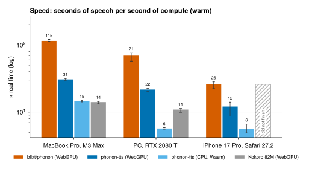
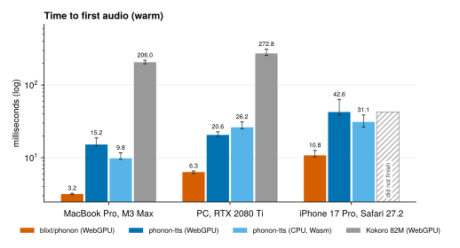
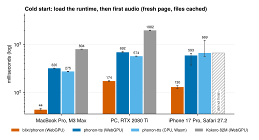
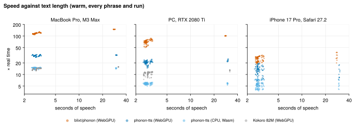
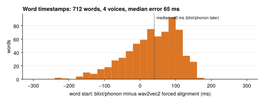
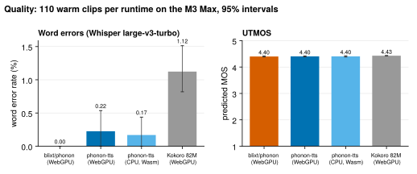

# Phonon on WebGPU

Fast text-to-speech in the browser, with a start and end time for every word.

[Try it in your browser](https://blixt.xyz/phonon/) (downloads 44.3 MB the first time) · [Listen to the benchmark phrases](https://blixt.xyz/phonon/listen.html)

## What it does

blixt/phonon is a WebGPU runtime for [Phonon 31M](https://huggingface.co/gradium/phonon-31m-en), an Apache-2.0 text-to-speech model by [Gradium](https://gradium.ai). Gradium did not make blixt/phonon.

- It makes 24 kHz English speech in any of Gradium's English voices, and streams the audio as it goes.
- It returns the start and end time of every word and token.
- The speaking speed goes from about 0.77× to 1.3×.
- It downloads Gradium's weights with the large matrices converted to 8-bit integers (43.7 MB, [on Hugging Face](https://huggingface.co/blixt/phonon-31m-en-webgpu)) and keeps them in the browser's cache.
- It runs in Chrome on macOS and Windows and in Safari on iOS. Firefox and Android are not tested.

Against Gradium's own browser package, [phonon-tts](https://www.npmjs.com/package/phonon-tts), on WebGPU:

- Speed: 115× real time against 31× on an M3 Max, 73× against 21× on an RTX 2080 Ti, and 26× against 13× on an iPhone 17 Pro.
- First audio of a sentence: 3 ms against 15 ms on the M3 Max, and 11 ms against 44 ms on the iPhone.
- A fresh page with the model cached: first audio after 46 ms against 373 ms on the M3 Max.
- First visit: 44.3 MB to download against 66.8 MB. With the download at 50 Mbit/s, first audio after 7.2 s against 10.9 s on the M3 Max, and 7.3 s against 11.3 s on the iPhone.
- Word times: phonon-tts gives none.
- Speech quality: Whisper heard no word errors in 110 clips, against 0.22% for phonon-tts. Speaker similarity is the same, and UTMOS predicts 4.40 for both.

## Results







<!-- results:start -->
| Device | Runtime | Speed (× real time) | First audio, warm (ms) | Cold start (ms) | First visit at 50 Mbit/s (s) | Download (MB) | All 11 phrases, warm (s) |
|---|---|--:|--:|--:|--:|--:|--:|
| MacBook Pro, M3 Max | **blixt/phonon** | 115 | 3.2 | 46 | 7.2 | 44.3 | 0.4 |
| MacBook Pro, M3 Max | phonon-tts, WebGPU | 31 | 14.9 | 373 | 10.9 | 66.8 | 1.8 |
| MacBook Pro, M3 Max | phonon-tts, CPU | 15 | 9.8 | 324 | 10.9 | 66.8 | 3.9 |
| MacBook Pro, M3 Max | Kokoro 82M, WebGPU | 14 | 207.4 | 847 | 54.1 | 331.1 | 4.1 |
| PC, RTX 2080 Ti | **blixt/phonon** | 73 | 6.1 | 177 | 7.3 | 44.3 | 0.7 |
| PC, RTX 2080 Ti | phonon-tts, WebGPU | 21 | 26.5 | 702 | 11.3 | 66.8 | 2.7 |
| PC, RTX 2080 Ti | phonon-tts, CPU | 6 | 25.5 | 569 | 11.1 | 66.8 | 10.1 |
| PC, RTX 2080 Ti | Kokoro 82M, WebGPU | 11 | 271.7 | 2022 | 55.5 | 330.0 | 5.2 |
| iPhone 17 Pro, Safari 27.2 | **blixt/phonon** | 26 | 10.7 | 147 | 7.3 | 44.3 | 2.1 |
| iPhone 17 Pro, Safari 27.2 | phonon-tts, WebGPU | 13 | 43.8 | 550 | 11.3 | 66.8 | 5.1 |
| iPhone 17 Pro, Safari 27.2 | phonon-tts, CPU | 6 | 31.2 | 568 | 12.0 | 66.8 | 10.5 |
| iPhone 17 Pro, Safari 27.2 | Kokoro 82M, WebGPU | did not finish | did not finish | did not finish | did not finish | – | did not finish |
<!-- results:end -->

Each value is a median, and the bars show the 25th and 75th percentiles. Speed is seconds of speech per second of compute, over every phrase of every warm run: 30× means that 10 seconds of speech take about a third of a second to make. Cold start is a fresh page that loads the runtime and speaks one sentence, with the files already in the browser's cache. First visit is the same on a page that first deletes everything its site stores, so it downloads every file, and it is given at 50 Mbit/s: the time any download was running is replaced by the bytes the visit downloaded at that speed. A first visit is otherwise mostly download time, which depends on the connection, not on the runtime. Its bytes are what came over the network (Download in the table) and each runtime's own code at its gzip size, as a static host serves it. Kokoro's first audio is its whole first sentence, because the benchmark gives it one sentence per call.

blixt/phonon gets faster as texts get longer, because each text has a fixed cost before its first frame. The other runtimes stay near one speed:



The word times come from the model's attention, corrected with the audio's loudness. This figure compares each word start with [wav2vec2](https://huggingface.co/facebook/wav2vec2-base-960h) forced alignment of the same audio:



All four runtimes speak clearly. [bench/quality.py](bench/quality.py) scored each runtime's 110 warm clips on the M3 Max with [Whisper large-v3-turbo](https://huggingface.co/openai/whisper-large-v3-turbo) and [UTMOS](https://github.com/tarepan/SpeechMOS):



## Listen

The [listening page](https://blixt.xyz/phonon/listen.html) plays every benchmark phrase from each runtime, side by side. The three Phonon runtimes use the same model and the same voice (Delia). They sample with different random numbers, so each clip is a different take of the same text. Kokoro 82M is a different model, there for reference. The clips are also in [docs/audio](docs/audio).

## Use it

```sh
npm install github:blixt/phonon   # the package is named phonon-webgpu
```

```js
import { Phonon } from "phonon-webgpu";

const tts = await Phonon.load({ progress: (percent) => console.log(percent) });
const speech = await tts.speak("The birch canoe slid on the smooth planks.", {
  voice: "Delia", // any English voice of Gradium's catalog: tts.voices
  speed: 1,
  onAudio: (samples) => {}, // each chunk, as soon as it exists
});
// speech.audio: Float32Array at speech.sampleRate (24000)
// speech.words: [{ text: "The", start: 0.13, end: 0.40 }, …], in seconds
// speech.tokens: the same for each token
```

`Phonon.load` throws when the browser has no WebGPU. The first load downloads 44.3 MB from Hugging Face (the weights, the tokenizer and a voice), and later loads read them from the browser's cache.

The code is in [src](src): [kernels.ts](src/kernels.ts) has the WGSL shaders, [lm.ts](src/lm.ts) the language model, [codec.ts](src/codec.ts) the audio decoder, [engine.ts](src/engine.ts) the loop that drives them and [timing.ts](src/timing.ts) the word times.

## How it works

Everything here goes beyond what the model card and the phonon-tts source say. "The reference" is the PyTorch model in Hugging Face Transformers (`GradiumPhononTTSForConditionalGeneration`), and the baseline is phonon-tts 0.6.0. Numbers marked (A/B) are the effect of one technique, measured with and without it on the M3 Max in headless Chrome. They are not from the benchmark above.

### Starting point

The engine is new code: WGSL compute shaders and TypeScript, with no phonon-tts, ONNX Runtime or WebAssembly inside. [bench/parity.py](bench/parity.py) checks the engine against the reference. It runs the reference in f32 with the engine's own noise in place of `torch.randn`, so both should make the same take of each text. On the 11 benchmark texts in the voice Delia, all 11 came out the same length to the frame (the Rainbow passage is 349 frames). The log-mel distance from the reference was 2.6 dB on average, and the waveforms correlated at 0.51. For scale, the reference with a different seed was 9.5 dB away, correlated at 0.21, and had a different length in 6 of the 11 texts. The waveforms are not identical, because int8 weights and an f16 key/value cache change the fine detail of each frame.

The tokenizer must be `tokenizer.5.0.0.json`, not `tokenizer.json`. Only the first has the 191 normalizer rules the model expects, which, for example, turn brackets into commas and add a final period. [tokenizer.ts](src/tokenizer.ts) runs those rules, Metaspace splitting and a Unigram Viterbi search with byte fallback, and its ids match the Python tokenizer.

### Weights

[scripts/build-weights.ts](scripts/build-weights.ts) converts Gradium's `model.safetensors` (the language model in bf16, the codec decoder in f32) once, with [checkpoint.ts](src/checkpoint.ts), into the file the library downloads from [blixt/phonon-31m-en-webgpu](https://huggingface.co/blixt/phonon-31m-en-webgpu). It does not use the GGUF file.

- The checkpoint stores rotary pairs interleaved (dims 2j and 2j+1). The converter moves the rows of q and k to halves (j and j+32) in each head, so a kernel rotates with two contiguous reads.
- The flow head does one LSD step, from time 0 to time 1. Its time embedding is the same at every step, and the converter adds it once to the bias of `cond_embed`.
- The codec's latent projection (1×1, no bias) is merged into the depthwise ×16 upsampling weights, and one kernel denormalizes, projects and upsamples the latents.
- The codec transformer's layer scales are multiplied into its output projection and second MLP weights.
- Convolution weights become [out][tap][in]. Transposed convolutions have kernel = 2 × stride, and each becomes one GEMM per output phase, [out][phase][tap][in], in which a kernel gathers its inputs and never scatters.
- Every tensor with 16,384 values or more becomes int8, with one f16 scale per 32 values along its rows. The scale is max |value| / 127 after rounding the values to f16, and quantized values round half to even. Other tensors stay f16. Shaders read the whole blob as `u32` words and unpack with `unpack4xI8` and `unpack2x16float`, and all arithmetic is f32, which means no shader needs the `shader-f16` feature.
- On the 110 warm clips per runtime of the benchmark, Whisper large-v3-turbo found no word errors in blixt/phonon's speech (95% interval 0 to 0%), against 0.22% (0 to 0.54%) for phonon-tts on WebGPU. The paired difference is −0.22 points (−0.53 to 0). WavLM speaker embeddings of blixt/phonon's clips are as close to phonon-tts's clips of the same text (cosine 0.988) as phonon-tts's clips are to each other across seeds (0.989). UTMOS predicts 4.40 for both. Nobody has run a listening test.
- The file is 43.7 MB, against 103 MB for the checkpoint and 64.5 MB for Gradium's GGUF file. `npm run build-weights` rebuilds it byte for byte, and its model card gives the SHA-256.

### Speed

In order of their effect:

1. The whole autoregressive loop stays on the GPU. A 32-byte state buffer holds the position the next step reads, the frame it makes, the end of speech and the codec's position (`STATE` in [kernels.ts](src/kernels.ts)), and each step's last kernel moves it on. The page encodes many steps into one submit without reading anything back. Results come back through mapped staging buffers, up to 3 submits behind the GPU.
2. One GEMV kernel does every single-row matrix product. 32 lanes work on each output row, each lane loads 16 bytes of weights at a time, and the lanes sum with subgroup operations where every subgroup has exactly 32 lanes (Apple and NVIDIA). Other GPUs use a shared-memory reduction, which is also tested. LayerNorm, with its affine weights and the flow head's adaLN modulation, runs as the GEMV's prologue in one pass (sum and sum of squares). Together with the int8 weights, this GEMV cuts the language model's step from 0.65 ms to 0.30 ms (A/B).
3. Each voice is prefilled once. A voice is 125 rows of speaker latents. The engine runs them through the 6 layers once and keeps their keys and values (1.5 MB in f16), and each text copies them into the cache and prefills only its own tokens. This cuts first audio from 8.8 ms to 4.9 ms (A/B).
4. Nothing is allocated per request. All buffers and bind groups exist from the start: about 108 MB, plus 1.5 MB for each voice used. The key/value cache is f16.
5. A step's attention is split over the keys (flash-decoding). 8 workgroups per head each take a share of the keys and leave a partial sum with its maximum, and the output projection's GEMV merges the splits in its prologue, at no extra dispatch. Inside a split, 8 lanes share each key for the scores, and 16 lanes × 8 key groups make the values. This halves a layer's attention, from 30 µs to 15 µs (A/B).
6. The GPU decides the end of speech. The step's last kernel computes the end-of-speech logit, and when it passes 4.0 the kernel writes how many frames to keep. Every heavy kernel reads that number and returns at once for later frames, which makes the steps a submit runs past the end cost about 2 µs each. On short texts, this raises the speed from 115× to 130× (A/B).
7. Audio comes out in chunks of 1, 2, 4 and then 8 frames. All chunk sizes share one decoder state: the codec transformer's ring of keys and values (window 251, ring 512 positions at 200 Hz) and each convolution stage's left context. After each chunk, a small kernel moves each stage's last rows to its front, and the convolutions never need a position. The engine clears that context before each text. Chunk size does not change the audio in my tests, though the repository has no test for it.
8. Pipelines compile in the background. Each bind group layout is read from its shader's `@binding` declarations, which lets bind groups exist before `createComputePipelineAsync` finishes. This cuts the first request after a load from about 53 ms to 13-19 ms (A/B).
9. The prefill has 4 fixed sizes. The text and BOS rows are padded to 64, 128, 192 or 256 rows, each size has prebuilt operations, and a text only writes its ids. Padding rows cannot change the real rows, because attention is causal. Each padding row writes keys and values at a position after BOS, and the step at that position writes its own key and value before it reads the cache. After the prefill, the BOS row is copied to row 0, where the step's flow head reads.
10. The codec's convolutions are split-K GEMMs with 64×64 tiles, A and B in shared memory as vec4 along K (16 KB, the portable limit). When a GEMM has few output tiles, K is split to reach about 160 workgroups and a second kernel sums the parts. Row tiles are capped at 4 when choosing the splits, so all text lengths share a few shader variants.
11. The prefill and the codec transformer use a flash-style attention kernel: 16 query rows share each tile of 16 keys in shared memory, with an online softmax. It gives about 2% (A/B).

An empty dependent dispatch costs about 1.6 µs in Chrome and WebKit on the M3 Max. A step has 48 dispatches (5 for each of the 6 layers, 18 for the flow head and the end of the step), and their barriers and ramps take about a third of its 300 µs.

### Word timings

1. Find a head that follows the text. I ran the reference on four texts and recorded each head's attention over the text tokens at every 80 ms frame. Each head got a score: the correlation between the frame number and the token it attends most, times the share of frames that do not move back, times its mean peak attention. Layer 3, head 0 scored 0.78. The next best (layer 3, head 5) scored 0.45, and all others 0.15 or less. Layer 3, head 0 has a correlation of 0.99 or more, never moves back and puts about 80% of its attention on one token.
2. Record it on the GPU. In every step, the layer 3 attention kernel writes head 0's scores over the text tokens into an alignment buffer, one row per frame. A small extra kernel in the prefill writes frame 0's row from the BOS row's query. After the text ends, the engine reads back the rows of the frames it kept: one small readback per text.
3. Turn the scores into a position. For each frame, take the token with the highest score and average the token index over the 2 tokens on each side of it, with softmax weights. The position never moves back.
4. Correct the lead. The head reaches a word about 230 ms (about 3 frames) before the audio does, and the times shift back by 3 frames. After a pause, the head reaches the next word 400 to 570 ms early, because it moves on when the previous word ends. A word start that falls where the audio is quieter than −45 dB (in 10 ms steps) moves to where the sound begins.
5. Group the tokens into words. A token that starts with ▁ starts a word, unless it is only punctuation.

I chose the 3-frame shift and the −45 dB threshold on 110 words of four other texts. On those words, a 4-frame shift without the silence step was a mean 110 ms from a wav2vec2 forced aligner, and the chosen settings were about 55 ms. The figure above is a held-out check on the 11 benchmark texts in 4 voices (712 words). Word starts are a mean 67 ms and a median 65 ms from the aligner, 76% are within 100 ms, and the 90th percentile is 125 ms. The median signed difference is +40 ms, with the engine later. Only word starts were scored, and the aligner has its own error of a few tens of milliseconds. The "never move back" rule could also hide a repeated or skipped word.

### Sampling

The flow head's noise comes from a PCG hash of the seed, the frame and the channel, through Box-Muller, at temperature 0.3. phonon-tts and the reference use other random number generators, and the same seed gives a different take of the same text.

A text ends when the end-of-speech logit passes 4.0, plus 1 frame, or 3 frames for a text of at most 4 words, as the checkpoint's `processor_config.json` says. A text gets at most (tokens / 3 + 2) seconds of frames, as in the reference, and never more than 768 frames (61 s). One text can have up to 240 tokens. [index.ts](src/index.ts) cuts longer texts at sentence ends, then at word ends, and joins the parts and their word times. Each part gets the next seed, because the noise depends on the seed and the frame, and each part starts again at frame 0.

Speed uses the model's `duration_delta` condition. The engine computes the condition vector and the BOS row for a value in the browser and writes them into the weights. I measured clip lengths at several values to make a table from speed to value: 0.77× at +0.6 and 1.3× at −0.45. Values below −0.45 made speech no faster. [pace.ts](src/pace.ts) interpolates the table.

### Failed experiments

- Allocating uniforms and split-K buffers for each text added up to 17.3 GB of GPU buffers over 412 requests, all left to the garbage collector.
- Averaging the token index over all tokens, not just around the peak, made the word highlight jump ahead: a little attention on the last token pulled frame 0 to about the 4th token.
- More attention splits (16 or 32 per head) changed nothing.
- Deeper submit queues, or batches of 8 frames before the GPU decided the end, were slower or delayed the first audio.
- Indirect dispatch to skip work past the end costs 5-6 µs per dispatch, against 1.6 µs for a direct one. Kernels that return at once are cheaper.
- vec4 shared-memory tiles in the codec GEMM gave no measurable gain over scalar tiles. The kernel keeps them, since they cost nothing. My first try had a data race: WGSL can store a whole vector when a thread writes one of its components, and threads must not share a vec4 that each writes in part. A padding column against bank conflicts did not fit in 16 KB.
- int4 weights for the language model and the flow head cut 43 MB to 29.5 MB with the same recognizer errors, but gave no speed. They moved clip lengths by up to ±10%, against ±3% for int8. Nobody listened to them, and int8 stayed.
- Chunks of 16 frames made a test hang. I did not find the cause, and chunks stop at 8.
- New split-K variants per text length made the first text of each new length compile new shaders (332 ms). Capping the row tiles at 4 fixed it.
- `layout: "auto"` drops bindings that a shader does not use, and a bind group with the full set then fails. Every kernel now touches all its bindings, and the layouts come from the declarations.
- More than 8 storage buffers in one shader breaks the portable limit. The weights are one buffer, bound once, and kernels get each tensor's offset in a uniform.
- An `uncapturederror` handler in a worker crashes the page after a synthesis in WebKit. The engine has none.

### Benchmark notes

- `kokoro-js` `stream()` never returned on a plain string here. The benchmark calls `generate` once per sentence.
- Headless WebKit with an in-memory profile keeps no Cache Storage between workers. Use a profile on disk.
- Playwright drops the page when a route fulfils a 100 MB body in Chromium. The benchmark redirects to a local server instead.
- The PC could not reach the Mac over Tailscale (a shared node is one-way). An SSH tunnel carried the page and Chrome's debugging port, and the page loaded as `localhost`, which WebGPU accepts as a secure origin.
- Kokoro 82M did not finish on the iPhone. A first visit and a cold run each finished once. After that, Safari either closed the tab on load ("A problem repeatedly occurred") or the page stopped before its first audio. Its fp32 model is 326 MB. The iPhone ran it on its own, after the three Phonon runtimes, because a crashed tab stops the page.
- On the iPhone, phonon-tts on the CPU ran on 1 thread in 5 of its 21 runs: its worker threads failed to start with "Out of memory", and it went on without them.

### Open work

- Fewer dispatches: folding the noise into the flow head's input GEMV, and the end-of-speech, output and latent projections into one workgroup, should give 3-6%.
- Faster codec convolutions: wider tiles per thread, and direct kernels for the last convolution (1 output channel) and `s3r1` (32 channels).
- Text normalization of numbers and symbols, as phonon-tts does.

## Method

| Device | Browser | Note |
|---|---|---|
| MacBook Pro, Apple M3 Max | Chrome 153, headless | Metal 3, 32-lane subgroups |
| PC, NVIDIA RTX 2080 Ti, AMD Ryzen 7 3700X, Windows 11 | Chrome 156, headless | Turing, 32-lane subgroups |
| iPhone 17 Pro (A19 Pro) | Safari 27.2 | Safari reports 4 CPU cores |

- Texts: the 10 Harvard sentences of list 1 (IEEE, 1969) and the first paragraph of the Rainbow Passage (Fairbanks, 1960), in [bench/phrases.json](bench/phrases.json).
- Runtimes: blixt/phonon, phonon-tts 0.6.0 on WebGPU and on the CPU (3 threads, `q8` weights, no text normalization so that both Phonon runtimes do the same work), and kokoro-js 1.2.1 with Kokoro 82M in fp32 on WebGPU. Both Phonon runtimes use the same model revision and the voice Delia. Kokoro uses `af_heart`.
- Runs: 10 rounds of first visits, then 10 rounds of cold runs and 10 rounds of warm runs. Each round runs every runtime once, in an order that rotates each round. One untimed cold run per runtime fills the caches again before the cold runs.
- First visits: before each one, the page deletes its site's Cache Storage, IndexedDB and origin private file system. Every fetch to another origin, in the page and in its workers, goes past the HTTP cache, and [bench/netcount.js](bench/netcount.js) records its bytes and when its first and last byte came. The runtimes' code comes from the benchmark server, and the analysis counts it at its gzip size. After each first visit, a 16 MB download from Hugging Face measures the connection. A cold run is a fresh page that loads the runtime and speaks the first Harvard sentence. A warm run is a fresh page that loads the runtime, speaks one untimed sentence, then speaks all 11 texts with that round's seed. The Mac and the PC each waited until their CPU was under 15% and their GPU under 10% for a minute before they started ([bench/wait-quiet.sh](bench/wait-quiet.sh) on the Mac). The iPhone ran with Safari in the foreground.
- First audio is the time from the call to the first chunk of audio.

To run it again:

```sh
npm install
npm run build
node bench/run.mjs                                  # serves the page and plans the runs
node bench/drive.mjs "http://127.0.0.1:7893/bench/?device=mac"   # or open that page on a device
python bench/plots.py && python bench/table.py      # figures and table
```

## Limits

- The browser must have WebGPU.
- Only English: blixt/phonon runs the 31M English model, which is Apache-2.0. Gradium's 40M models are CC BY-NC 4.0, and blixt/phonon does not load them.
- phonon-tts can write out numbers, amounts and symbols as words before it speaks. blixt/phonon cannot, and numbers read best written as words.
- The word times follow the model's attention. They are not a forced alignment.

## Credits and license

The model, its tokenizer and its voices are by [Gradium](https://gradium.ai), under the Apache License 2.0. Phonon builds on [Pocket TTS](https://github.com/kyutai-labs/pocket-tts) and the Mimi codec by [Kyutai](https://kyutai.org). This repository does not include the model. The code downloads Gradium's tokenizer and voices from Hugging Face at pinned revisions, and the converted weights from [blixt/phonon-31m-en-webgpu](https://huggingface.co/blixt/phonon-31m-en-webgpu), which credits Gradium.

The code in this repository is under the [Apache License 2.0](LICENSE). See [NOTICE](NOTICE).
